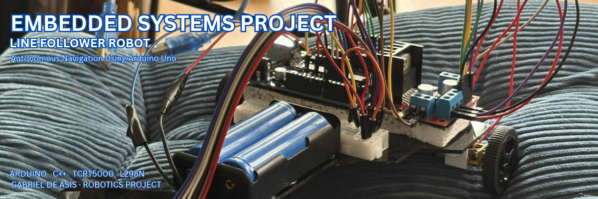

<p align="center">
  
</p>

<h1 align="center">
  Arduino Line Follower Robot
</h1>

<p align="center">
  Autonomous Navigation Using Arduino Uno
</p>

# Arduino Line Follower Robot

An autonomous line-following robot built using an Arduino Uno, a 5-channel TCRT5000 infrared sensor array, and an L298N dual H-bridge motor driver.

The robot detects and follows a black line on a white surface using sensor-based position detection and proportional steering control.

## Project Overview

This project demonstrates the development of an autonomous mobile robot capable of following a predefined path. It processes infrared sensor readings to determine the position of a black line and adjusts the speed of its left and right motors to maintain its trajectory.

The system uses an Arduino Uno as its main controller, a TCRT5000 sensor array for line detection, and an L298N motor driver to control two N20 DC geared motors.

## Features

- Five-channel infrared line detection.
- Real-time sensor reading and processing.
- Proportional steering control.
- Independent left and right motor speed adjustment using PWM.
- Differential motor control for directional correction.
- Line-loss detection and directional recovery.
- Adjustable motor speed and proportional gain.

## Hardware Components

| Component | Quantity | Purpose |
| Arduino Uno R3 | 1 | Main microcontroller |
| TCRT5000 5-channel sensor array | 1 | Infrared line detection |
| L298N motor driver | 1 | DC motor control |
| N20 DC geared motors | 2 | Robot movement |
| Wheels | 2 | Locomotion |
| 7.4V 2S battery pack | 1 | Power supply |
| Robot chassis | 1 | Hardware mounting |
| Jumper wires | As needed | Electrical connections |

## Software and Technologies

- Arduino C/C++
- Arduino IDE
- PWM motor control
- Digital sensor interfacing
- Proportional control algorithm
- Embedded systems programming

## System Architecture

The robot follows this processing sequence:

1. The TCRT5000 sensor array detects the black line.
2. The Arduino reads the five digital sensor outputs.
3. Each sensor is assigned a position weight.
4. The program calculates the line position error.
5. Proportional control determines the steering correction.
6. The Arduino adjusts the PWM signals sent to the L298N.
7. The motors change their respective speeds to correct the robot's direction.

## Sensor Position Mapping

The five sensors are arranged from left to right.

| Sensor | Position Weight |
| Far Left | -2 |
| Left | -1 |
| Center | 0 |
| Right | +1 |
| Far Right | +2 |

The calculated error determines the robot's steering direction.

- Negative error: Line detected on the left.
- Zero error: Line detected near the center.
- Positive error: Line detected on the right.

## Pin Configuration

### TCRT5000 Sensor Array

| Sensor | Arduino Pin |
| OUT1 | A0 |
| OUT2 | A1 |
| OUT3 | A2 |
| OUT4 | A3 |
| OUT5 | A4 |
| VCC | 5V |
| GND | GND |

### L298N Motor Driver

| L298N Pin | Arduino Pin |
| ENA | D5 |
| IN1 | D7 |
| IN2 | D8 |
| ENB | D6 |
| IN3 | D9 |
| IN4 | D10 |

### Motor Connections

| L298N Output | Motor |
| OUT1, OUT2 | Left N20 motor |
| OUT3, OUT4 | Right N20 motor |

## Project Structure

```text
arduino-line-follower-robot/
│
├── README.md
├── LICENSE
├── .gitignore
│
├── src/
│   └── line_follower/
│       └── line_follower.ino
│
├── hardware/
│   ├── components.md
│   └── pin-configuration.md
│
├── project-photos/
```

## Installation and Setup

### Requirements

- Arduino IDE
- Arduino Uno R3
- TCRT5000 sensor array
- L298N motor driver
- Two N20 DC geared motors

### Steps

1. Clone this repository.

```bash
git clone https://github.com/gabrieldeasis21/arduino-line-follower-robot.git
```

2. Open the Arduino IDE.

3. Navigate to:

```text
src/line_follower/line_follower.ino
```

4. Connect the Arduino Uno to your computer using a USB cable.

5. Select Arduino Uno under Tools > Board.

6. Select the appropriate serial port.

7. Upload the program to the Arduino.

8. Test the robot on a white surface with a black line.

## Algorithm and Control Parameters

The robot uses proportional steering control.

The steering correction is calculated as:

```text
correction = Kp * error
```

The motor speeds are adjusted using:

```text
leftSpeed  = baseSpeed + correction
rightSpeed = baseSpeed - correction
```

Initial control parameters:

| Parameter | Value |
| Base speed | 130 |
| Maximum speed | 200 |
| Proportional gain (Kp) | 45 |
| Loop delay | 5 ms |

These values can be adjusted depending on the sensor calibration, motor characteristics, and track conditions.

## Testing and Validation

The following tests should be performed before deployment:

- Verify individual sensor readings.
- Confirm black and white surface detection.
- Test left and right motor direction.
- Validate PWM motor speed control.
- Test straight-line tracking.
- Test left and right turns.
- Evaluate line-loss recovery.

## Known Limitations

- The current implementation uses digital sensor readings.
- Steering performance depends on sensor calibration and track conditions.
- The controller uses proportional control without integral or derivative terms.
- Sharp turns and intersections may require additional handling logic.

## Future Improvements

- Implement PID control for improved steering accuracy.
- Add sensor calibration routines.
- Introduce adjustable speed profiles.
- Implement intersection and junction detection.
- Add an OLED display for real-time sensor monitoring.
- Optimize battery consumption and motor performance.

## License

This project is licensed under the MIT License. See the [LICENSE](LICENSE) file for details.

## Author

Gabriel De Asis

Computer Science Student  
Cavite State University – Silang Campus

GitHub: [gabrieldeasis21](https://github.com/gabrieldeasis21)
